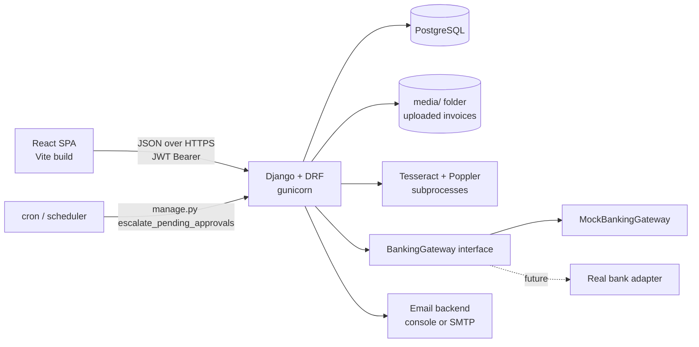

# Architecture

## Components

Django apps: `accounts` (users, roles, JWT), `invoices` (upload, OCR, extraction, validation), `vendors`, `procurement` (PO, GRN, import, matching), `workflow` (rules, steps, notifications, escalation), `payments`, `dashboard` (summary and reports, being added on this branch).

## Request flow: uploading an invoice

1. Browser sends `POST /api/invoices/` with a multipart file and the `Authorization: Bearer` token.
2. DRF authenticates via simplejwt and `HasRole("requester", "ap_admin")` checks the role.
3. The serializer checks extension, non-empty size and magic bytes, then saves the file under `media/`.
4. In the same request: OCR, extraction, validation, optional PO matching, optional start of approval. Each stage can append exception rows.
5. The invoice is saved with its final status and returned with its exceptions.

OCR is synchronous on purpose (see out-of-scope below), so requests can take several seconds; gunicorn's timeout is raised in the Dockerfile.

## Data model summary

Core tables: User, Invoice (with InvoiceException), Vendor (encrypted bank fields), PurchaseOrder, GoodsReceiptNote, ApprovalRule, ApprovalStep, Notification, Payment. Money amounts on POs/GRNs/payments are decimals; the invoice's extracted fields are kept as text because OCR output is unreliable. See [DATABASE_SCHEMA.md](DATABASE_SCHEMA.md) for the ER diagram and column lists.

## Security model

- **Authentication:** JWT, 30 min access token, 1 day refresh.
- **Authorization:** server-side `HasRole` on every write path; the UI hiding a button is convenience, not protection. Approval steps may only be decided by a user whose role matches the step.
- **Self-registration** cannot choose a privileged role (fixed after review).
- **Bank details:** Fernet encrypted in the database, masked in API responses for everyone except AP Admin. The key lives in `FIELD_ENCRYPTION_KEY`.
- **Uploads:** extension plus magic-byte check, empty files refused.
- **Concurrency:** row locks around approval decisions and payment requests prevent double-processing.
- **Dev defaults to change in production:** `DJANGO_SECRET_KEY`, `FIELD_ENCRYPTION_KEY`, `DJANGO_DEBUG`, database password. The settings file ships insecure development defaults for all of them.

## Error-handling model

The backend returns standard HTTP status codes. `frontend/src/lib/api.ts` classifies each failure into an `ApiError` with a `kind`:

| Kind | Triggered by | UI treatment |
|---|---|---|
| unauthorized | 401 | session-expired notice, redirect to login |
| forbidden | 403 | "You don't have access" message |
| not_found | 404 | "couldn't be found" message / 404 page for routes |
| validation | 400 (and other 4xx) | field errors shown under the inputs, first message as summary |
| conflict | 409 | friendly "someone else already changed this" toast, then refresh |
| network | fetch failed | banner "Can't reach AP Automation" with retry |
| server | 5xx | "something's wrong on our end" with retry; an error boundary catches render crashes |

## Deliberately out of scope

- **IMAP email ingestion:** planned but not built. Invoices enter by manual upload only.
- **Background workers (Celery):** OCR runs inside the request. Simpler and deterministic for a demo, but a slow file blocks a gunicorn worker. The upgrade is a task queue plus a "processing" status.
- **Real bank and ERP:** payments go to a mock; POs and GRNs are entered by CRUD/CSV, not synced.
- **Fix-and-resubmit flow** for Needs Review invoices, and a route to approval for invoices without a PO.
- **PDF report export** (CSV only), native mobile app (responsive web only), frontend test suite.
- **Object storage for uploads:** files sit on local disk rather than object storage (e.g. S3-compatible storage).
