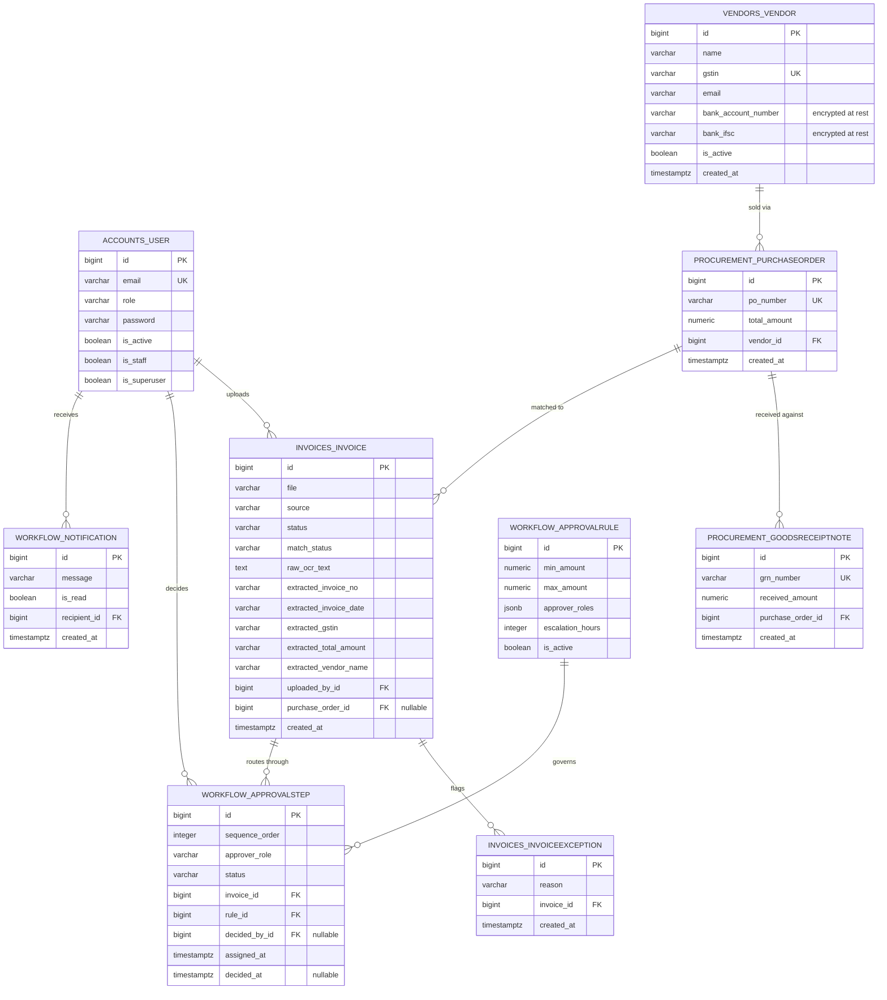

# Database Schema — AP Automation

PostgreSQL 16+. Generated from the live schema via `pg_dump --schema-only` (structure only, no data) — see the raw SQL at `docs/schema/schema.sql`. Framework tables (`auth_group*`, `django_admin_log`, `django_content_type`, `django_session`, `django_migrations`) are Django's own and omitted below for clarity; they carry no application data.

## Entity-relationship diagram



## Tables

### `accounts_user`
The single user table for all four roles (no separate profile table — `role` is a field directly on the user).

| Column | Type | Notes |
|---|---|---|
| `id` | bigint PK | |
| `email` | varchar(254), unique | login identifier (`USERNAME_FIELD`) |
| `role` | varchar(20) | `requester`, `approver`, `ap_admin`, `vendor` |
| `password` | varchar(128) | Django's salted-hash format, never plaintext |
| `is_active`, `is_staff`, `is_superuser` | boolean | standard Django auth flags |

### `vendors_vendor`
The vendor master. `bank_account_number` and `bank_ifsc` are encrypted at the application layer (Fernet symmetric encryption) before being stored — the column type is `varchar`, but the stored bytes are ciphertext, not plaintext.

| Column | Type | Notes |
|---|---|---|
| `id` | bigint PK | |
| `gstin` | varchar(20), unique | GST identification number, validated via modulo-36 checksum before save |
| `bank_account_number`, `bank_ifsc` | varchar(255) | encrypted at rest; API responses mask the account number to all roles except `ap_admin` |
| `is_active` | boolean | inactive vendors fail invoice validation |

### `procurement_purchaseorder`
**FK → `vendors_vendor.vendor_id`** (every PO belongs to exactly one vendor).

| Column | Type | Notes |
|---|---|---|
| `id` | bigint PK | |
| `po_number` | varchar(100), unique | |
| `total_amount` | numeric(14,2) | |
| `vendor_id` | bigint FK → `vendors_vendor.id` | `ON DELETE PROTECT` (a vendor with POs can't be deleted) |

### `procurement_goodsreceiptnote`
**FK → `procurement_purchaseorder.purchase_order_id`** (a GRN always confirms delivery against one PO; a PO can have multiple GRNs for split deliveries).

| Column | Type | Notes |
|---|---|---|
| `id` | bigint PK | |
| `grn_number` | varchar(100), unique | |
| `received_amount` | numeric(14,2) | |
| `purchase_order_id` | bigint FK → `procurement_purchaseorder.id` | `ON DELETE CASCADE` |

### `invoices_invoice`
The central table. **FK → `accounts_user.uploaded_by_id`** and **FK → `procurement_purchaseorder.purchase_order_id`** (nullable — an invoice doesn't have to be linked to a PO to exist, only to be matched).

| Column | Type | Notes |
|---|---|---|
| `id` | bigint PK | |
| `file` | varchar(100) | path to the uploaded PDF/image |
| `source` | varchar(10) | `manual` or `email` |
| `status` | varchar(20) | `uploaded` → `extracted` → `needs_review` \| `validated` → `pending_approval` → `approved` \| `rejected` |
| `match_status` | varchar(20) | `unmatched`, `matched`, `mismatched` — independent of `status` |
| `raw_ocr_text` | text, nullable | full Tesseract OCR output, kept for audit/debugging |
| `extracted_*` | varchar, nullable | the five fields the regex extraction layer pulls from `raw_ocr_text` |
| `uploaded_by_id` | bigint FK → `accounts_user.id` | `ON DELETE PROTECT` |
| `purchase_order_id` | bigint FK → `procurement_purchaseorder.id`, nullable | `ON DELETE SET NULL` |

### `invoices_invoiceexception`
**FK → `invoices_invoice.invoice_id`.** One row per validation/matching failure reason — an invoice with 3 problems gets 3 rows, not one row with a combined message. This is what populates the manual-review/exceptions queue.

| Column | Type | Notes |
|---|---|---|
| `id` | bigint PK | |
| `reason` | varchar(255) | human-readable, e.g. "Vendor not found in master" |
| `invoice_id` | bigint FK → `invoices_invoice.id` | `ON DELETE CASCADE` |

### `workflow_approvalrule`
The configurable approval matrix. The first active rule whose `[min_amount, max_amount)` range contains an invoice's amount applies to it.

| Column | Type | Notes |
|---|---|---|
| `id` | bigint PK | |
| `min_amount`, `max_amount` | numeric(14,2) | the amount band this rule covers |
| `approver_roles` | jsonb | an ordered list of roles, e.g. `["approver", "ap_admin"]` — one `ApprovalStep` is created per role, all in parallel |
| `escalation_hours` | integer | how long a step can sit pending before the escalation job reassigns it |
| `is_active` | boolean | |

### `workflow_approvalstep`
**FK → `invoices_invoice.invoice_id`, FK → `workflow_approvalrule.rule_id`, FK → `accounts_user.decided_by_id`** (nullable until decided). One row per required approver per invoice.

| Column | Type | Notes |
|---|---|---|
| `id` | bigint PK | |
| `sequence_order` | integer | position within the rule's role list |
| `approver_role` | varchar(20) | which role this step is assigned to |
| `status` | varchar(20) | `pending`, `approved`, `rejected`, `escalated` |
| `assigned_at`, `decided_at` | timestamptz | `decided_at` null until a decision is recorded |
| `decided_by_id` | bigint FK → `accounts_user.id`, nullable | |

### `workflow_notification`
**FK → `accounts_user.recipient_id`.** In-app notification center; every notification also triggers an email via the same call.

| Column | Type | Notes |
|---|---|---|
| `id` | bigint PK | |
| `message` | varchar(500) | |
| `is_read` | boolean | |
| `recipient_id` | bigint FK → `accounts_user.id` | `ON DELETE CASCADE` |

## Relationship summary

```
accounts_user ──< invoices_invoice (uploaded_by)
accounts_user ──< workflow_approvalstep (decided_by, nullable)
accounts_user ──< workflow_notification (recipient)

vendors_vendor ──< procurement_purchaseorder (vendor)

procurement_purchaseorder ──< procurement_goodsreceiptnote (purchase_order)
procurement_purchaseorder ──< invoices_invoice (purchase_order, nullable)

invoices_invoice ──< invoices_invoiceexception (invoice)
invoices_invoice ──< workflow_approvalstep (invoice)

workflow_approvalrule ──< workflow_approvalstep (rule)
```

`vendors_vendor.gstin` is also the join key `validate_invoice`/`match_invoice` use at the application level to cross-check an invoice's OCR'd GSTIN against the vendor master and the PO's vendor — it isn't a declared foreign key (the invoice stores the GSTIN as free text from OCR, which may not resolve to any vendor row), but it's the de facto relationship driving validation and matching.
