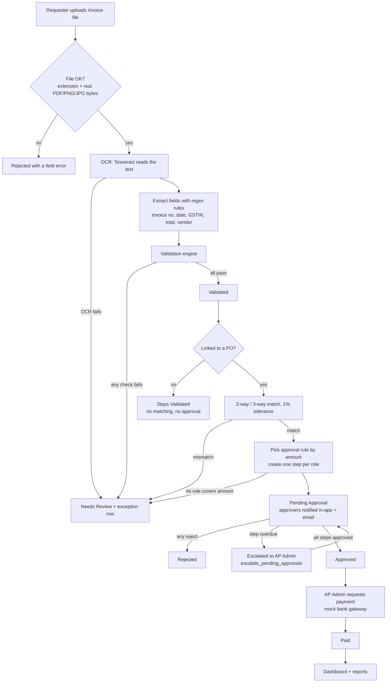
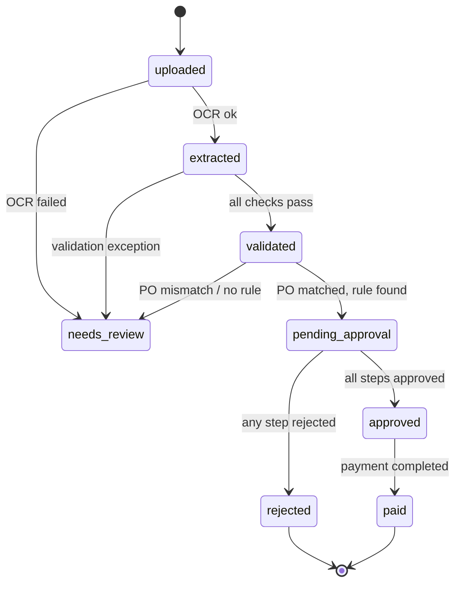

# How It Works (product-owner edition)

No code knowledge needed. This explains what the system does with an invoice, who does what, and why key choices were made.

## The lifecycle

In words:

1. **Upload.** Only Requesters and AP Admins can upload. The file must be a real PDF, PNG or JPG (the first bytes are checked, so a renamed `.exe` is refused).
2. **OCR.** Tesseract converts the picture or PDF pages into text. This is synchronous: the upload request waits for it (a few seconds).
3. **Extraction.** Small pattern rules find the five fields. Each rule is limited to one line and shaped like the field it wants (a date looks like a date, a GSTIN is 15 characters), so it cannot swallow half the page.
4. **Validation.** Missing mandatory fields, bad GSTIN checksum, vendor not in the master list or inactive, non-positive or unreadable amount, or a duplicate (same invoice number and vendor as an invoice that is not rejected or in review) each add an exception row.
5. **Exceptions queue.** An invoice with exceptions is **Needs Review**. The reasons are shown against the invoice.
6. **Matching.** Only for invoices linked to a purchase order. Invoice vendor GSTIN must equal the PO's vendor; invoice amount must be within 1% of the PO; if goods receipts (GRNs) exist, their total must also be within 1% of the PO and the invoice.
7. **Approval matrix.** An admin-defined rule says "amounts from X up to (not including) Y need these roles". Each role becomes a step; steps run in parallel. Everyone with that role gets a notification and an email.
8. **Escalation.** Running `python manage.py escalate_pending_approvals` (meant to be scheduled, for example every hour via cron) marks overdue pending steps as escalated and creates a replacement step for AP Admin.
9. **Payment.** An AP Admin requests payment on an Approved invoice. The mock bank returns a reference and the invoice becomes Paid. One payment per invoice.
10. **Reports.** The dashboard and five reports read the same records.

## Who does what

| Role | Can do |
|---|---|
| Requester | Upload invoices, view invoice list, view vendors/POs, see notifications |
| Approver | Approve/reject steps assigned to the approver role |
| AP Admin | Everything a requester can, manage vendors/POs/GRNs/CSV imports, decide escalated steps, request payments, see full bank details |
| Vendor | Can log in; no invoice, approval or payment actions (only read-only views) |

## What each status means

| Status | Meaning |
|---|---|
| Uploaded | File saved, processing not finished yet (normally very brief) |
| Extracted | OCR text and fields captured, validation pending (brief) |
| Needs Review | At least one exception (bad field, OCR failure, mismatch, no approval rule, no approver). A human has to look |
| Validated | All checks passed. Without a PO it stays here |
| Pending Approval | Matched and waiting for approver steps |
| Approved | Every approval step approved (escalated steps count as handled by their replacement) |
| Rejected | Any approver rejected |
| Paid | Payment completed at the (mock) bank |

Two honest notes: a Needs Review invoice has no in-app "fix and resubmit" action yet (the exception list is the review surface), and an invoice without a PO has no route to approval in the current code.

## Decisions you can defend in an interview

**1. Regex extraction, not an LLM.** Why: works offline, no API key or cost, deterministic and unit-testable, easy to explain. Tradeoff: brittle against new invoice layouts. Tested against a real tax invoice, the vendor name from the letterhead and OCR-misread dates still need manual review. Honest framing: the OCR engine (Tesseract LSTM) is a neural network; the field-finding layer is plain rules, designed to be swappable (DECISIONS.md #4).

**2. Mock bank behind an interface.** `BankingGateway` is an abstract class; `MockBankingGateway` always succeeds; the `BANKING_GATEWAY` setting picks the implementation. Why: no real bank API is reachable, and sending fabricated data to a real one would be irresponsible. Tradeoff: no failure handling is exercised, and the "processing" and "failed" statuses exist in the model but the mock never produces them. Swapping in Razorpay later touches one class.

**3. Encryption at rest for bank details.** Vendor account number and IFSC are stored with Fernet (symmetric, authenticated) and shown masked to anyone but AP Admin. Tradeoff: you cannot search or index the encrypted columns, and losing `FIELD_ENCRYPTION_KEY` makes the data unrecoverable. Rotating the key needs a re-encrypt migration.

**4. Derived audit log.** The audit report is assembled from records that already exist (invoices, exceptions, approval steps with who/when, payments) instead of a separate audit table that could drift from reality. Tradeoff: it only shows what the tables retain; for example, fields edited in place or deleted rows leave no history.

**5. Typed error handling.** The frontend turns every failed call into one of seven kinds (unauthorized, forbidden, not_found, validation, conflict, network, server), and each kind has one standard UI treatment. Why: no page invents its own error text, and internal server strings do not leak to users. Tradeoff: a little indirection, and unknown 4xx codes fall back into the generic "validation" kind.

**6. Locking for money-like actions.** Approval decisions and payment requests run in database transactions with row locks, so two people cannot both decide a step or request the same payment. Tradeoff: slightly more complex code; the payoff is that races produce a clean 409, not double effects.
